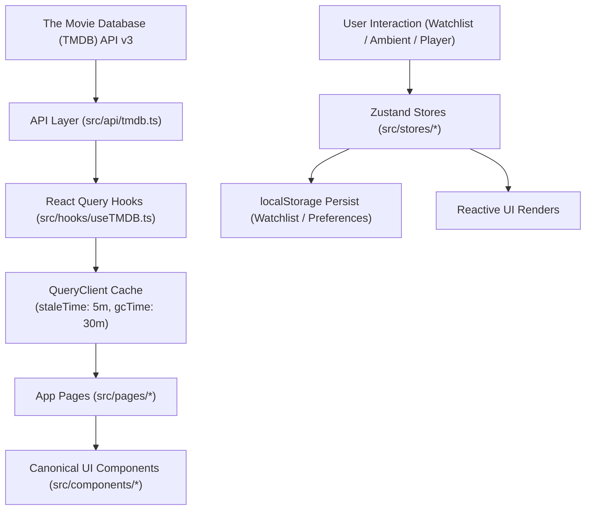

# CineBai Architecture Documentation

CineBai is a calm, cinema-first web application for discovering movies, television series, and anime, powered by The Movie Database (TMDB) metadata.

---

## 1. Routes & Page Architecture

| Route | Component | Code-Split Chunk | Description |
| :--- | :--- | :--- | :--- |
| `/` | `HomePage` | `HomePage.tsx` | Hero spotlight carousel, trending rails (week & today), top rated, network rails, anime spotlight |
| `/movies` | `BrowsePage` (`mediaType='movie'`) | `BrowsePage.tsx` | Feature films catalog, sortable by popularity, rating, release date, filterable by genre |
| `/tv` | `BrowsePage` (`mediaType='tv'`) | `BrowsePage.tsx` | Television series catalog, sortable by popularity, rating, air date, filterable by genre |
| `/movie/:id` | `DetailPage` (`mediaType='movie'`) | `DetailPage.tsx` | Film overview, TMDB rating, runtime, director, cast rail, YouTube trailer modal, similar films |
| `/tv/:id` | `DetailPage` (`mediaType='tv'`) | `DetailPage.tsx` | Series overview, seasons & episode guide, cast rail, YouTube trailer modal, similar series |
| `/anime` | `AnimePage` | `AnimePage.tsx` | Japanese animation spotlight (`ANIME_GENRE_ID = '16'`, `JAPANESE_LANG = 'ja'`) with infinite scroll |
| `/network/:network` | `NetworkPage` | `NetworkPage.tsx` | Curated network studio catalogs (Netflix, Prime, Disney+, Apple TV+, Hulu, HBO Max) |
| `/search` | `SearchPage` | `SearchPage.tsx` | Debounced multi-search with person-result filtering, pagination, and trending search chips |
| `/watchlist` | `WatchlistPage` | `WatchlistPage.tsx` | Saved title queue with local persistence, type filtering, sorting, and screen reader announcements |
| `/watch/:type/:id` | `WatchPage` | `WatchPage.tsx` | Player view with embed provider cycling, episode selector, keyboard shortcuts (`s` for server switch) |
| `*` | `NotFoundPage` | `NotFoundPage.tsx` | 404 recovery page with links to Home and Movie Browse |

All routes are lazy-loaded via `React.lazy()` with route-level `Suspense` fallbacks displaying accessible skeletons (`aria-busy="true"`).

---

## 2. Data Flow Architecture

1. **API Client (`src/api/tmdb.ts`)**:
   - Centralizes all endpoints, request formatting, and authorization headers (`VITE_TMDB_ACCESS_TOKEN`).
   - Provides graceful mock fallbacks (`src/api/mockData.ts`) when API tokens are missing or network requests fail.
   - Houses named constants: `ANIME_GENRE_ID`, `JAPANESE_LANG`, `WATCH_REGION`, and `WATCH_PROVIDER_IDS`.
2. **Data Fetching Hooks (`src/hooks/useTMDB.ts`)**:
   - Built on TanStack Query (`@tanstack/react-query`).
   - Configured with a default `staleTime` of 5 minutes and `gcTime` of 30 minutes to eliminate redundant fetches across page navigation.
   - Provides infinite query hooks (`useInfiniteSearchMulti`, `useDiscoverTVShows`, `useDiscoverMovies`) with standard TMDB pagination parameters.

---

## 3. State Management

All state stores reside strictly in `src/stores/`:

### `stores/watchlistStore.ts`
- Manages user-saved titles.
- Configured with Zustand `persist` middleware (version: 1, migration strategy, `partialize` to persist items and exclude transient UI states).
- FIFO item cap: Limits stored entries to **500 items**, silently evicting the oldest additions when exceeded.
- Deduplication: Prevents duplicate entries and updates an `aria-live` announcement region to inform screen reader users.

### `stores/player.ts`
- Coordinates video player interface state (volume, active server, theater mode).
- Clamps volume safely between `0.0` and `1.0`.
- Chapters are derived exclusively from actual media tracks (defaults to empty array `[]` without invented placeholder timestamps).
- Progress reflects authentic viewing timestamps without synthetic progress bars.

### `stores/ambient.ts`
- Controls dynamic background ambient illumination canvas colors (`primary`, `secondary`, `accent`).
- Persists user enable/disable preference in `localStorage`.
- Automatically responds to `prefers-reduced-motion` and hardware capability tiers (`capabilities.ts`).

---

## 4. Design System & Design Tokens

Styling is built with Tailwind CSS v4 and defined in `src/index.css` via the `@theme` directive:

- **Surface & Backgrounds**:
  - `--color-bg-base`: `#08080A` (Deep dark cinema base)
  - `--color-bg-surface`: `#101014` (Surface cards and containers)
  - `--color-bg-elevated`: `#18181E` (Dropdowns, modals, and search inputs)
  - `--color-bg-overlay`: `rgba(8, 8, 10, 0.8)` (Backdrops and modal overlays)
- **Typography & Accents**:
  - `--color-accent`: `#E5A93C` (Warm cinematic amber gold)
  - `--color-accent-hover`: `#F0B955`
  - `--color-on-accent`: `#08080A`
  - `--color-text-primary`: `#F3F4F6` (High contrast reading)
  - `--color-text-secondary`: `#C7CAD1` (Metadata, subtitles, overviews)
  - `--color-text-tertiary`: `#8B8F9A` (Muted labels and tags)
- **Borders & Dividers**:
  - `--color-border-subtle`: `rgba(255, 255, 255, 0.06)`
  - `--color-border-default`: `rgba(255, 255, 255, 0.12)`
  - `--color-border-strong`: `rgba(255, 255, 255, 0.22)`
- **Glass Materials & Capabilities**:
  - Configured in `src/styles/apple-glass.css`.
  - Tier-C devices or users with `prefers-reduced-transparency` receive solid elevated fallbacks without expensive `backdrop-filter` blurs.
- **Unified Clearance Rule**:
  - All pages and content containers implement bottom padding ensuring content clears the floating dock:
    `pb-[calc(96px+env(safe-area-inset-bottom))]` (72px dock height + 24px clearance gap).

---

## 5. Canonical UI Component Selections

To prevent component duplication and fragmentation, the application enforces singular canonical components:

1. **Card (`src/components/cards/MovieCard.tsx`)**:
   - The sole card component used across all grids, rails, and carousels.
   - Standard 2:3 aspect ratio (`aspect-[2/3]`), TMDB `w342` image resolution, rating pill, and instant watchlist toggle.
2. **Hero (`src/components/home/CinematicHero.tsx`)**:
   - The sole hero banner component.
   - Incorporates directional scrims (horizontal gradient + vertical gradient) for text contrast, real title spacing, 24px hit area pagination pills, and a 44x44 accessible autoplay toggle button.
3. **Dock (`src/components/layout/FloatingDock.tsx`)**:
   - The sole primary navigation element.
   - Centered floating glass pill with active route indicator, safe-area inset support, and 44px minimum touch targets.
4. **Canvas (`src/components/ambient/AmbientCanvas.tsx`)**:
   - The sole ambient lighting system.
   - Dynamic fluid canvas that extracts dominant colors from posters and backdrops. Responsively scales blob radii (capped on mobile) and respects `prefers-reduced-motion`.
5. **Player (`src/components/player/LiquidVideoPlayer.tsx` / `src/pages/WatchPage.tsx`)**:
   - The sole media player container.
   - Standard `aspect-video` container, responsive server cycling (`s` key), and embed provider abstraction.
